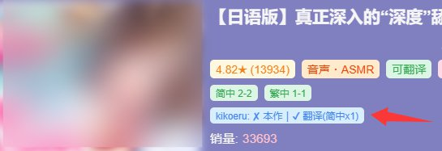
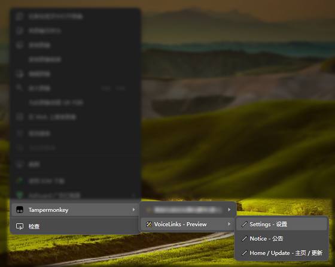
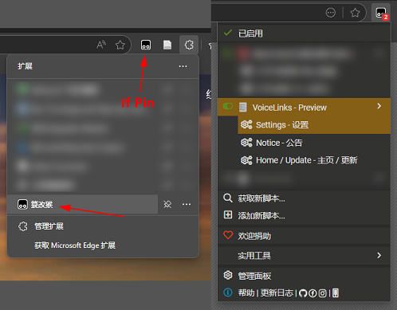
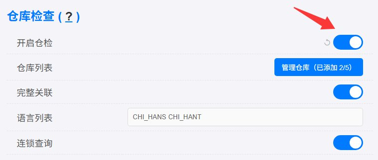
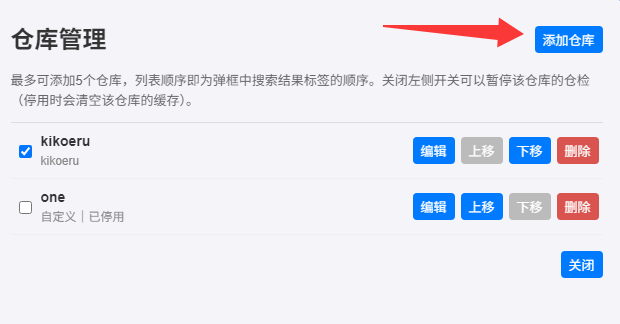

_Translated by DeepSeek_

---

# v5.0.x New Feature (SPA Page Parsing Support & Repository Check Upgrade)
- Parsing support for SPA and other dynamically rendered pages
- Repository Check upgrade: multiple repositories, repository presets, automatic username/password login

---

## Feature Description
This update contains two parts.

### 1. Parsing support for SPA and other dynamically rendered pages
On some sites, clicking a button or link renders new content dynamically through JavaScript, without triggering a page refresh or reload. In such cases, previous versions of the script could not recognize the newly appeared RJ codes, and stale link nodes were easily left behind.

This version updates the parsing logic for these pages and improves compatibility with dynamic websites. If you encounter a parsing problem while using the script, please include the page URL, your browser version, and the steps to reproduce it in your report so that we can improve it further.

### 2. Repository Check upgrade
The Repository Check feature has been significantly upgraded: setting up a kikoeru repository is now much simpler, and a custom preset has been added to support repositories built on other frameworks. The main changes are:

- **Multiple repositories**: Up to **5 repositories** can be added, and several of them can be enabled at the same time. Each repository is shown as its own search result label in the pop-up.
- **Repository manager**: Adding, editing, reordering, enabling/disabling, and deleting repositories are all handled in a dedicated repository manager, and the settings interface has been greatly improved.
- **Repository presets**: A built-in `kikoeru` preset simplifies the previous settings (it supports automatic username/password login), and a **custom preset** has been added for repositories built on other frameworks (see below).

**_Because Repository Check has changed a lot, please open the repository manager from the settings page after updating and verify that your existing repository configuration is correct. If anything goes wrong, delete the existing repository and add it again._**

---

## Screenshots

---

## How to Use Repository Check
### Open the repository manager
1. Open the settings: right-click in your browser and select `Tampermonkey` (extension name) → `VoiceLinks` (script name) → `Settings - 设置`.

Alternatively, click the Tampermonkey icon in your browser's extension area and find the settings button under the script name.

2. In the settings page, find the `Repository Check` section and turn on the `Enable Repository Check` switch.

3. Click the `Manage repositories` button on the right side of `Repository list` to open the repository manager.
4. Click `Add repository` in the top-right corner, fill in the repository information, and click `Add`.

_Hover over a setting title to see its description._

_Adding, editing, reordering, enabling/disabling, and deleting repositories in the repository manager are **saved and applied immediately**; the other options on the settings page (`Enable Repository Check`, `Full linkage`, `Language list`, `Chained search`) require clicking the save button at the bottom of the settings page._

### Add a kikoeru repository
_Note: this preset is only guaranteed to work with the `number17/kikoeru` management framework. Other similar forks may work as well, or may require the custom preset._

In the repository editor, choose `kikoeru` for `Preset type`, then fill in:
- **Repository name**: Shown in front of the search result label. Multiple repositories may share the same name.
- **Repository URL**: The root URL of the repository, i.e. the link you normally use to access it, for example `https://example.com`.
- **API URL**: Only needed when the repository frontend and API are hosted separately (for example when the API uses its own domain or port). Leave it empty to use the repository URL above.
- **Authentication**:
  - `Username/Password Login`: Enter the repository's username and password. The script logs in automatically when needed and caches the token, and logs in again automatically once the token expires.
  - `Fixed Request Headers`: For cases where username/password login is not available. You need to fill in the authentication information manually in `Custom Request Headers` below (for example a token you copied by hand).
  - `No Authentication`: The repository can be queried without any authentication.
- **Custom Request Headers**: Usually left empty. If the repository API requires specific headers to be accessible (for example an authentication header from a reverse proxy), fill them in here, one `key:value` per line.

### Add a repository on another framework (custom preset)
In the repository editor, choose `Custom` for `Preset type`. The custom preset adapts to other frameworks through a "data description", where you can fill in:

- **Search URL Template**: The repository's search API address, where `%s` is replaced with the search keyword (the RJ code), for example `https://example.com/api/search?keyword=%s`.
- **Result Page URL Template**: The address opened when a search result label is clicked, where `%s` is likewise replaced with the RJ code. If left empty, clicking the label opens nothing.
- **Request Method**: `GET` or `POST`.
- **Request Body Template** (shown when POST is selected): The request body to send, where `%s` is replaced with the RJ code. Leave it empty to send an empty body, for example `{"keyword":"%s"}`.
- **Request Body Type** (shown when POST is selected): `JSON` or `Form (x-www-form-urlencoded)`.
- **Authentication**: Same as for a kikoeru repository: `No Authentication`, `Fixed Request Headers`, or `Username/Password Login`. When you choose `Username/Password Login`, you also need to fill in the login API address, the login request body (`%username%` and `%password%` are replaced with the username and password respectively), the login request body type, the path of the token in the response (for example `token` or `data.token`), and the request header that carries the token (for example `Authorization: Bearer {token}`).
- **Work List Path**: The path of the work list in the JSON response (for example `works` or `data.list`).
- **Work ID Field**: The name of the field that identifies a work in the list (for example `id` or `workno`).
- **Work ID Conversion**: Used to map a work identifier to an RJ code:
  - `Auto`: Use the value directly if it is a complete RJ code; match by number if it is a plain number.
  - `Use as Work Code`: The value must be a complete RJ code.
  - `Match by Number`: Ignore the RJ code prefix and match by the numeric part only, which suits repositories that return numeric IDs only.

_If you don't know the search API address, you can find it in your browser's developer tools (`F12`) → `Network` tab: search for any RJ code in the repository and look for the request in the list. For detailed steps, refer to the [previous version's document](../v4.9.x/v4.9.x-en_US.md)._

### Search result labels with multiple repositories
Every **enabled** repository produces one search result label, whose content is `Repository name: result text`, and the labels are ordered the same way as the repository list. The symbols and colors have the same meaning as in the previous version:
- Green: The repository has the current work.
- Blue: The current work is not present, but translations of it are.
- Orange: Neither the current work nor its translations are present, but the original is.
- Gray: The current work and any other related works are all absent.
- Ending with ⏳: The search results are not fully loaded yet (results update as the search runs).
- Showing ❌error: Loading failed for this repository.

**When the pop-up is pinned**, clicking a repository's label opens the result pages of all works found **in that repository**; if nothing was found in that repository, it opens the search result page for the current RJ code in that repository.

### Disabling and deleting repositories
- Turn off the switch on the left side of the repository list to **disable** that repository: no further requests will be sent to it (an ongoing chained search stops immediately as well).
- Clicking `Delete` removes **all settings data** of that repository.
- If you only want to **temporarily** exclude a repository, use the disable switch instead of deleting it, so that its configuration is kept.

---

## Settings and Other Q&A
For explanations of the settings, hover over the corresponding setting titles in the settings page. Below are common questions and answers:

---

### How many repositories can I add? Can I add two repositories of the same kind?
Up to 5 repositories can be added; once the limit is reached, the `Add repository` button becomes unclickable. This limit mainly exists for response time and safety reasons, so that querying too many repositories at once does not slow down the response or get you blocked. If needed, it can be bypassed at the source code level.

Multiple repositories of the same kind can be added (for example two kikoeru repositories connecting to different servers), and repository names may be duplicated.

---

### The repository frontend and API are hosted separately. How should I fill in the addresses?
Fill them in separately in the repository editor: put the frontend address in `Repository URL` and the API address in `API URL`. If either one is left empty, the script uses the other one, so filling in just one also works.

---

### Why does a repository's label show `❌error`?
`❌error` means that this particular query failed for that repository, and the other repositories are unaffected. Troubleshooting steps:
1. Pin the pop-up with the Ctrl key (a hint is shown in the bottom-left corner of the pop-up), then click the failing label; the script will open that repository's result page URL.
2. If the result page cannot be opened normally, the cause may be:
   - A network connection error
   - A wrong repository URL
   - The HTTPS problem mentioned later in this Q&A
3. If the result page opens normally, the cause may be:
   - A problem with that repository's authentication configuration (wrong authentication method, username/password, token header, etc.). Try logging in to the repository in your browser to confirm that the account works.
   - The custom preset's parsing configuration not matching the actual response (work list path, work ID field, work ID conversion, etc.)
   - A script bug (please double-check using the notes below)

In general, if `❌error` appears, it should appear for all RJ codes in that repository. If you see the following instead, it is most likely a script bug, so please report it together with the RJ code you searched, the name of the failing repository, and the repository framework version (author / download source / repository URL):
- Only some RJ codes show `❌error` while others work fine
- Search results load halfway and then suddenly turn into `❌error`

---

### HTTP works, but HTTPS gives an error?
This may be caused by a non-standard certificate on the repository site, such as a self-signed certificate, a mismatched certificate domain, or an expired certificate.

In that case, **visit the repository URL manually once**. Your browser should show a warning (`net::ERR_CERT_COMMON_NAME_INVALID` or a similar error).

Click `Advanced`, then click `Proceed to xxxxxx (unsafe)`. After visiting the site normally once, the feature should work.

---

### How to manually debug?
**Script issues:** Open the developer tools (`F12`) and check the `Console` for errors coming from the VoiceLinks userscript. Error messages related to repositories include the name of the failing repository, which makes it easier to tell which repository the problem belongs to.

**Network issues:** Check Tampermonkey's `background page` (in your browser's extension management page, enable developer mode, find Tampermonkey, and click `Inspect views: background.html`). In its `Network` tab you can inspect all network requests made by the script.

---

### I want to support a new repository framework
Feedback on GitHub is welcome. When reporting, please provide:
- The name, framework, and version of the repository (author / download source / repository URL)
- If you are the author of that repository framework, the repository's API documentation or similar information as well, so that support can be added more quickly.
